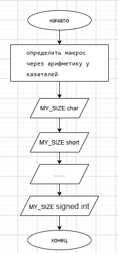

# Лабораторная работа №13
  
Студент: Полякова В.Д.
Группа: бТИИ-261

## Задание

Напишите программу, которая вычисляет размер основных типов данных в байтах:

1) char

2) short int

3) unsigned short int

4) int

5) unsigned char

6) wchar_t

7) long long int

8) size_t

9) float

10) double

11) signed int

**Требуется:**
1. Составить блок-схему алгоритма решения.
2. Написать программу на языке C.

## Блок-схема

